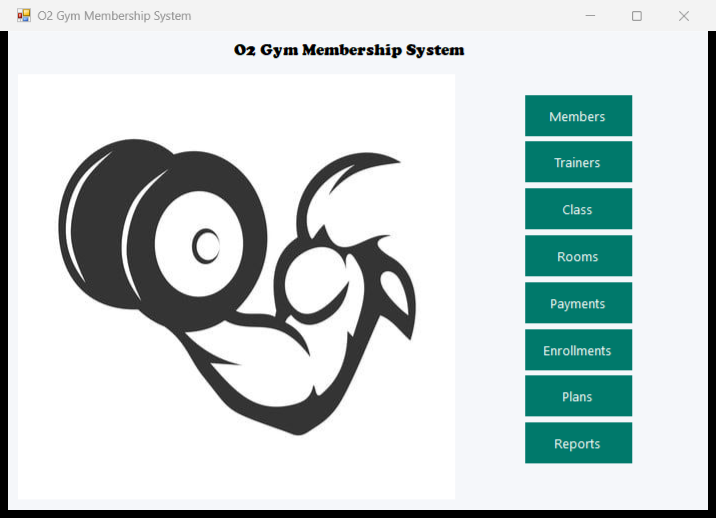
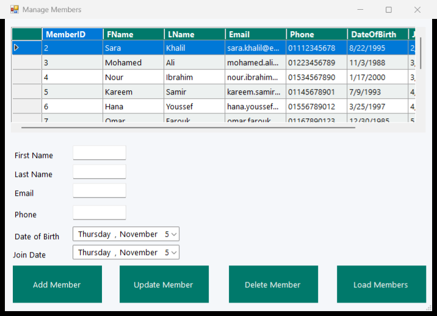
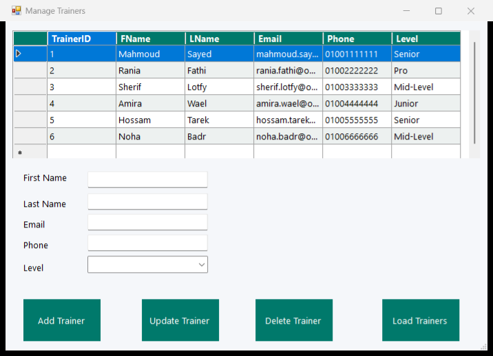
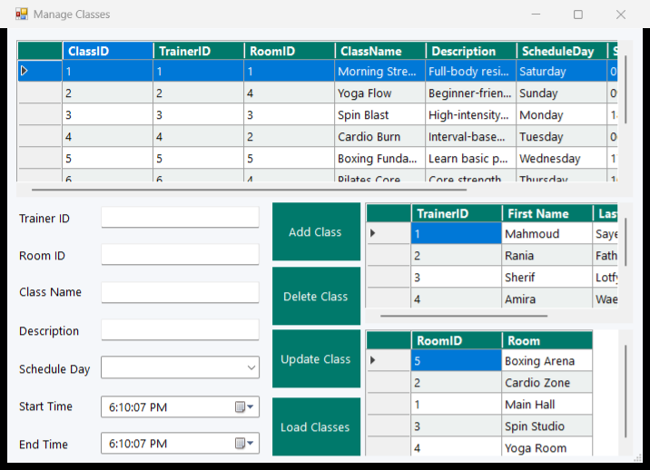
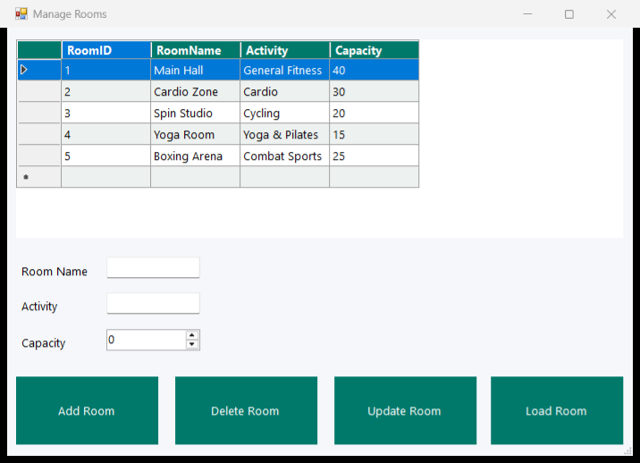
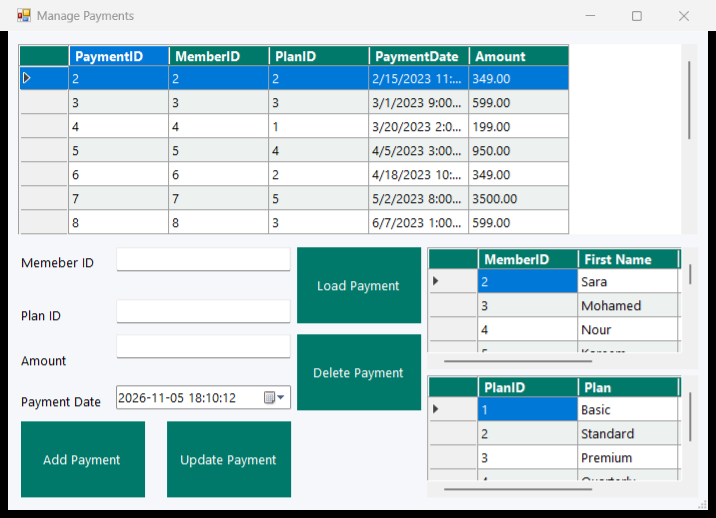
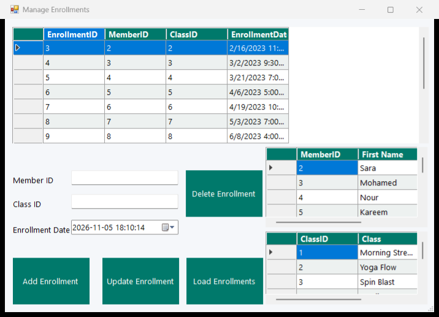
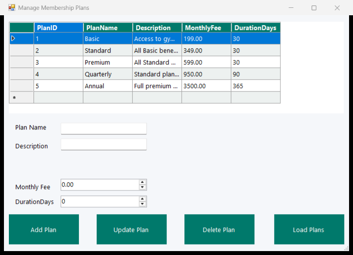
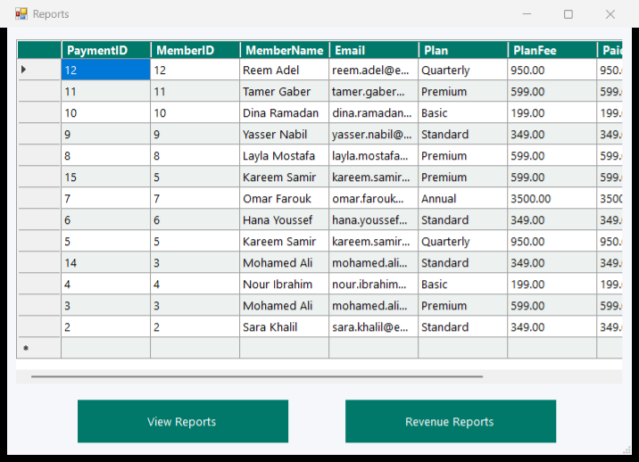

# O2 Gym Membership System

A Windows desktop application for managing a gym's day-to-day operations — members, trainers, rooms, classes, membership plans, payments, and class enrollments — backed by a MySQL database.

Built as a university database course project to demonstrate relational schema design, constraints, multi-table joins, aggregate reporting, and stored procedures/functions, wrapped in a C# WinForms front end.

## Screenshots

| Main Menu | Members |
|---|---|
|  |  |

| Trainers | Classes |
|---|---|
|  |  |

| Rooms | Payments |
|---|---|
|  |  |

| Enrollments | Membership Plans |
|---|---|
|  |  |

| Reports |
|---|
|  |

## Features

- **Members** — add, update, delete, and browse gym members with date-of-birth/join-date validation at the database level.
- **Trainers** — manage trainer records with a seniority level (`Junior` → `Pro`).
- **Rooms** — manage gym rooms/studios and their activity type and capacity.
- **Classes** — schedule classes against a trainer, a room, a day of week, and a time range, with live reference lists for picking valid trainer/room IDs.
- **Membership Plans** — define plans with a monthly fee and duration.
- **Payments** — log member payments against a plan, with quick-fill reference grids (double-click a member or plan to populate the form).
- **Enrollments** — enroll members into classes, enforcing one enrollment per member/class pair.
- **Reports** — member payment history (via a stored procedure) and total revenue grouped by plan.

## Tech stack

| Layer | Technology |
|---|---|
| UI | C# WinForms, .NET Framework 4.7.2 |
| Data access | ADO.NET via [MySql.Data](https://www.nuget.org/packages/MySql.Data) (MySQL Connector/NET) 9.7.0 |
| Database | MySQL 8.0 |
| Build | MSBuild / Visual Studio 2022 |

### Architecture

```
GymMembershipSystem/
├── Program.cs                  # entry point
├── UiTheme.cs                  # shared look & feel applied to every form
├── DataAccess/
│   └── DatabaseHelper.cs       # thin ADO.NET wrapper (parameterized queries)
└── Forms/
    ├── MainMenu.cs             # launcher / navigation hub
    ├── Form1.cs                # Members
    ├── TrainerForm.cs
    ├── RoomForm.cs
    ├── ClassForm.cs
    ├── PaymentForm.cs
    ├── PlanFrom2.cs             # Membership Plans
    ├── EnrollmentForm.cs
    └── ReportsForm.cs
GymMembershipSystem.sql          # schema + seed data + stored procs/functions
```

Each management screen follows the same pattern: a `DataGridView` bound to a `SELECT`, with Add/Update/Delete buttons that build a **parameterized** `MySqlCommand` through `DatabaseHelper`, and reference grids where relevant (e.g. the Payments screen lets you double-click a member or plan row to auto-fill the form).

### Database schema

Seven tables (`MEMBER`, `TRAINER`, `ROOM`, `PLAN`, `CLASS`, `PAYMENT`, `ENROLLMENT`) with foreign keys, `CHECK` constraints, and `UNIQUE` constraints, plus:

- **Stored procedures:** `GetMemberPaymentHistory`, `GetMemberEnrollments`, `AddMemberWithPlan` (transactional), `GetRevenueByPlan`, `DeleteMemberAndCleanup`
- **Functions:** `CalculateMemberAge`, `GetTotalSpent`

See [`GymMembershipSystem.sql`](GymMembershipSystem.sql) for the full schema, seed data, and report queries.

## Getting started

### Prerequisites

- **Visual Studio 2022** (Community is fine) with the ".NET desktop development" workload — or just the Build Tools + .NET Framework 4.7.2 targeting pack
- **MySQL Server 8.0**

### 1. Clone

```sh
git clone https://github.com/hassanxadel/Gym-Database-App.git
cd Gym-Database-App
```

### 2. Create the database

```sh
mysql -uroot -p < GymMembershipSystem.sql
```

This creates the `GymMembershipSystem` database, all tables/constraints, the stored procedures/functions, and seeds it with sample members, trainers, rooms, classes, plans, payments, and enrollments.

### 3. Configure the connection string

```sh
cp GymMembershipSystem/App.config.example GymMembershipSystem/App.config
```

Edit `App.config` and set `Pwd=` in the `GymDb` connection string to your MySQL password:

```xml
<connectionStrings>
  <add name="GymDb" connectionString="Server=localhost;Database=GymMembershipSystem;Uid=root;Pwd=YOUR_PASSWORD;" />
</connectionStrings>
```

> `App.config` is gitignored since it holds a local credential — only `App.config.example` is committed.

### 4. Build & run

```sh
MSBuild GymMembershipSystem.sln -t:Rebuild -p:Configuration=Debug
```

Then run `GymMembershipSystem/bin/Debug/GymMembershipSystem.exe`, or open the solution in Visual Studio and press **F5**.

## Security notes

- All Add/Update/Delete queries use parameterized `MySqlCommand`s (no string-concatenated SQL), so user input — including names containing quotes — can't break or inject into a query.
- Database credentials live outside source control, in a local `App.config` built from the committed `App.config.example` template.

## License

This project was built for educational purposes as part of a university database course.
